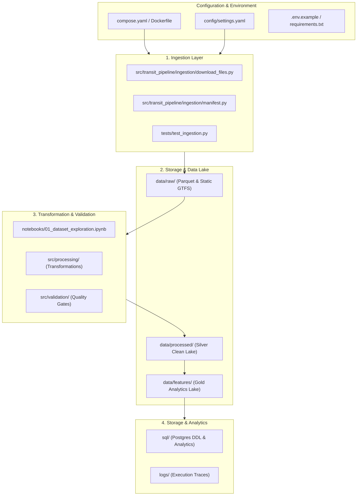

# Project Structure & File Role Documentation

This document provides a comprehensive guide to the directory tree and every individual file within the **Transit Delay System** (Bus Observatory Data Engineering Platform), detailing its specific role, architectural context, and interaction with other components across the platform.

---

## 1. Complete Directory Tree

```text
transit-delay-system/
├── .dockerignore
├── .env.example
├── .gitignore
├── .md
├── compose.yaml
├── Dockerfile
├── ENVIRONMENT.md
├── PROJECT_STRUCTURE.md
├── requirements.txt
├── ROADMAP.md
├── image.png
├── image-1.png
│
├── config/
│   └── settings.yaml
│
├── data/
│   ├── data.md
│   ├── image.png
│   ├── raw/
│   │   ├── COMPACTED_nyct_mta_bus_gtfsrt_2026-10-16_18_03_57.parquet
│   │   └── gtfs_static/
│   │       ├── google_transit_manhattan.zip
│   │       └── manhattan/
│   │           ├── agency.txt
│   │           ├── calendar.txt
│   │           ├── calendar_dates.txt
│   │           ├── feed_info.txt
│   │           ├── routes.txt
│   │           ├── shapes.txt
│   │           ├── stop_times.txt
│   │           ├── stops.txt
│   │           └── trips.txt
│   ├── processed/
│   └── features/
│
├── docs/
│   ├── data_dictionary.md
│   ├── decisions.md
│   └── source_assessment.md
│
├── logs/
│
├── notebooks/
│   └── 01_dataset_exploration.ipynb
│
├── sql/
│
├── src/
│   ├── transit_pipeline/
│   │   ├── __init__.py
│   │   ├── config.py
│   │   └── ingestion/
│   │       ├── __init__.py
│   │       ├── download_files.py
│   │       └── manifest.py
│   ├── processing/
│   └── validation/
│
└── tests/
    └── test_ingestion.py
```

---

## 2. File Roles & Documentation

Every file in the repository serves a distinct purpose within the end-to-end data platform lifecycle:



---

### 2.1 Root Infrastructure & Environment Configuration

| File | Primary Role & Description |
|---|---|
| [`compose.yaml`](file:///home/daoudi/Documents/projects/transit-delay-system/compose.yaml) | **Multi-Service Container Orchestrator:** Defines Docker Compose services (`transit-python`, `transit-jupyter`, and `transit-postgres`), networking (`transit-delay-system_default`), bind mounts for live code editing, environment variables, port mappings (Jupyter `8888`, PostgreSQL `5432`), and persistent storage volumes (`postgres_data`). |
| [`Dockerfile`](file:///home/daoudi/Documents/projects/transit-delay-system/Dockerfile) | **Base Container Image Specification:** Builds the Debian-based `python:3.12-slim` image used by both the pipeline execution container and JupyterLab. Sets `/app` working directory, disables Python bytecode generation (`PYTHONDONTWRITEBYTECODE=1`), unbuffers logging output (`PYTHONUNBUFFERED=1`), and installs dependencies from `requirements.txt`. |
| [`requirements.txt`](file:///home/daoudi/Documents/projects/transit-delay-system/requirements.txt) | **Python Dependency Manifest:** Lists third-party libraries required across all services: `pandas` (tabular processing), `pyarrow` (Parquet I/O), `boto3` (AWS S3 connectivity), `requests` (HTTP downloads), `jupyterlab` (interactive exploration), `sqlalchemy` & `psycopg2-binary` (PostgreSQL connectivity), `python-dotenv` (environment variables), `pytest` (test execution), and `pyyaml` (YAML configuration parser). |
| [`.dockerignore`](file:///home/daoudi/Documents/projects/transit-delay-system/.dockerignore) | **Docker Build Exclusion List:** Prevents bloat by ensuring temporary artifacts (`.git`, `.venv`, `__pycache__`, `.ipynb_checkpoints`), secrets (`.env`), and heavy directories (`data/`, `logs/`) are not sent into the Docker build context. |
| [`.gitignore`](file:///home/daoudi/Documents/projects/transit-delay-system/.gitignore) | **Git Version Control Filter:** Protects the repository from committing secrets (`.env`), transient runtime data (`data/`, `logs/`), compiled Python bytecode (`*.pyc`, `__pycache__/`), virtual environments (`.venv/`), and test coverage caches. |
| [`.env.example`](file:///home/daoudi/Documents/projects/transit-delay-system/.env.example) | **Environment Variable Template:** Provides developers with reference configuration keys and safe default credentials for PostgreSQL (`POSTGRES_DB`, `POSTGRES_USER`, `POSTGRES_PASSWORD`, `POSTGRES_PORT`), Jupyter token, local data directories, and optional cloud storage (AWS S3) credentials. |
| [`ENVIRONMENT.md`](file:///home/daoudi/Documents/projects/transit-delay-system/ENVIRONMENT.md) | **Runtime Environment & Operations Guide:** Detailed documentation detailing container topologies, networking, volume mounts, service specifications, connection URIs, daily operational commands (starting, stopping, executing scripts, running `pytest`, and `psql` shell access), and maintenance workflows. |
| [`ROADMAP.md`](file:///home/daoudi/Documents/projects/transit-delay-system/ROADMAP.md) | **End-to-End Project Roadmap:** The master engineering specification outlining all 14 phases (Phases 0 through 13) of the project—from environment setup and dataset reconnaissance to streaming pipelines (Kafka + Spark), batch scheduling (Airflow), and Grafana monitoring. |
| [`.md`](file:///home/daoudi/Documents/projects/transit-delay-system/.md) | **Initial Project Scratchpad:** Early notes summarizing the directory purpose, project technology stack across stages, and ASCII pipeline architecture flow. |
| [`image.png`](file:///home/daoudi/Documents/projects/transit-delay-system/image.png) & [`image-1.png`](file:///home/daoudi/Documents/projects/transit-delay-system/image-1.png) | **Exploration & Architecture Artifacts:** Visual diagrams and terminal/pipeline snapshot graphics generated or captured during initial system design and exploration. |

---

### 2.2 Pipeline Configuration (`config/`)

| File | Primary Role & Description |
|---|---|
| [`config/settings.yaml`](file:///home/daoudi/Documents/projects/transit-delay-system/config/settings.yaml) | **Central Pipeline Configuration:** Declarative YAML configuration decoupling file paths and network parameters from application code. Defines: <ul><li>Storage locations: `raw_dir` (`/app/data/raw`), `manifest` (`/app/data/raw/manifest.jsonl`), and `logs_dir` (`/app/logs`).</li><li>Download resilience parameters: `timeout_seconds: 120`, `max_retries: 3`, and exponential backoff base `backoff_seconds: 2`.</li><li>Dataset download registry: URLs, classifications (`gtfs_static` vs. `realtime`), and target destinations for all 5 NYC borough schedule archives (Manhattan, Bronx, Brooklyn, Queens, Staten Island) and realtime vehicle position archives.</li></ul> |

---

### 2.3 Core Pipeline Package (`src/transit_pipeline/`)

The source directory holds modular, tested Python code responsible for dataset ingestion, configuration loading, transformations, and quality control:

| File / Directory | Primary Role & Description |
|---|---|
| [`src/transit_pipeline/__init__.py`](file:///home/daoudi/Documents/projects/transit-delay-system/src/transit_pipeline/__init__.py) | **Package Initialization:** Marks the `transit_pipeline` directory as an importable Python root package. |
| [`src/transit_pipeline/config.py`](file:///home/daoudi/Documents/projects/transit-delay-system/src/transit_pipeline/config.py) | **Configuration Manager:** Exposes `load_config(path: Path)` to safely parse and return the application settings from `config/settings.yaml` as a typed Python dictionary. |
| [`src/transit_pipeline/ingestion/__init__.py`](file:///home/daoudi/Documents/projects/transit-delay-system/src/transit_pipeline/ingestion/__init__.py) | **Ingestion Subpackage Init:** Defines the ingestion subpackage boundary. |
| [`src/transit_pipeline/ingestion/download_files.py`](file:///home/daoudi/Documents/projects/transit-delay-system/src/transit_pipeline/ingestion/download_files.py) | **Resilient File Downloader & Ingestion CLI:** Production-grade download orchestrator featuring: <ul><li>Streaming chunked downloads into temporary files (`<filename>.part`).</li><li>Exponential backoff retries (`wait = backoff * 2 ** (attempt - 1)`) for transient network/HTTP failures.</li><li>Integrity validation checking file sizes, confirming `.zip` validity via `zipfile.is_zipfile()`, and validating Parquet files via `pq.ParquetFile()`.</li><li>Atomic replacement (`tmp.replace(dest)`) to ensure partial downloads never corrupt the raw lake.</li><li>Manifest integration: logs download status, file sizes, and SHA-256 hashes to `manifest.jsonl`.</li><li>CLI flags: `--dry-run` (simulate actions), `--limit N` (sample ingestion), and `--force` (bypass manifest check).</li></ul> |
| [`src/transit_pipeline/ingestion/manifest.py`](file:///home/daoudi/Documents/projects/transit-delay-system/src/transit_pipeline/ingestion/manifest.py) | **Ingestion Manifest & Idempotency Tracker:** Manages `manifest.jsonl` to ensure idempotent pipeline runs: <ul><li>`sha256_file()`: Generates cryptographic SHA-256 checksums of raw downloaded files.</li><li>`already_ingested()`: Verifies whether a given source URL has already been downloaded and verified on disk, skipping redundant downloads.</li><li>`append_record()` / `make_record()`: Appends structured JSON metadata (source key, local path, byte size, checksum, discovery time, and error traces) for auditability.</li></ul> |
| [`src/processing/`](file:///home/daoudi/Documents/projects/transit-delay-system/src/processing/) | **Data Transformation Package (Stage 3):** Dedicated directory for upcoming transformation modules (cleaning duplicate observations, normalizing UTC timestamps to `America/New_York`, calculating distance deltas, and producing Silver zone Parquet datasets). |
| [`src/validation/`](file:///home/daoudi/Documents/projects/transit-delay-system/src/validation/) | **Data Quality Gates (Stage 4):** Dedicated directory for automated schema validators, null-rate boundary checks, coordinate bounding box assertions, and referential integrity tests. |

---

### 2.4 Automated Test Suite (`tests/`)

| File | Primary Role & Description |
|---|---|
| [`tests/test_ingestion.py`](file:///home/daoudi/Documents/projects/transit-delay-system/tests/test_ingestion.py) | **Ingestion Unit Tests:** Automated pytest suite that tests edge cases without hitting external networks: <ul><li>`test_download_success`: Verifies valid download, `.part` cleanup, and final file creation using mocked HTTP responses.</li><li>`test_retry_then_success`: Tests exponential backoff recovery after transient HTTP 503 errors.</li><li>`test_fails_after_retries`: Confirms that permanent failures raise `DownloadError` and clean up temporary `.part` files.</li><li>`test_empty_file_rejected`: Ensures 0-byte downloads are rejected.</li><li>`test_invalid_zip_rejected`: Ensures HTML error pages masked as ZIP files fail validation.</li><li>`test_already_ingested`: Confirms idempotency logic accurately skips existing files and redownloads if a file is deleted from disk.</li></ul> |

---

### 2.5 Architecture & Technical Documentation (`docs/`)

| File | Primary Role & Description |
|---|---|
| [`docs/decisions.md`](file:///home/daoudi/Documents/projects/transit-delay-system/docs/decisions.md) | **Architecture Decision Log (ADR):** Records foundational engineering choices: selecting New York City Transit (`nyct_mta_bus_gtfsrt`) as the primary vehicle feed, using a 24-hour baseline file (Oct 15–16, 2026), standardizing raw storage in UTC while converting to `America/New_York` for business logic, defining lake tiering (Raw $\rightarrow$ Silver $\rightarrow$ Gold), and deferring delay prediction until static schedule joins are proven. |
| [`docs/source_assessment.md`](file:///home/daoudi/Documents/projects/transit-delay-system/docs/source_assessment.md) | **Data Source Reconnaissance & Feasibility Report:** Thorough technical assessment of the Bus Observatory archive: evaluates 3,054,703 observations across 5,137 buses, documents null distributions (0% nulls across primary fields, 57.6% nulls on `occupancy_status`), identifies duplicate patterns, verifies NYC coordinate boundaries (lat 40.50–40.93, lon -74.25 to -73.70), and analyzes the feasibility of calculating transit delays versus occupancy prediction. |
| [`docs/data_dictionary.md`](file:///home/daoudi/Documents/projects/transit-delay-system/docs/data_dictionary.md) | **Dataset Schema & Field Dictionary:** Reference catalog defining field definitions, source types, canonical types, allowed value ranges, nullability constraints, and descriptions across both GTFS-Realtime feeds and GTFS Static tables. |

---

### 2.6 Exploration & Prototyping (`notebooks/`)

| File | Primary Role & Description |
|---|---|
| [`notebooks/01_dataset_exploration.ipynb`](file:///home/daoudi/Documents/projects/transit-delay-system/notebooks/01_dataset_exploration.ipynb) | **Exploratory Data Analysis Notebook:** JupyterLab notebook used during Phase 1 for hands-on data discovery: <ul><li>Reads raw Parquet metadata and schemas using PyArrow without loading complete files into memory.</li><li>Computes summary statistics, distinct vehicle counts, and route distribution.</li><li>Inspects Manhattan static GTFS schedule files (`trips.txt`, `stop_times.txt`).</li><li>Implements and tests the Haversine distance formula to match GPS vehicle observations against scheduled stop coordinates.</li><li>Validates schedule-to-observation joins and tests delay calculation logic.</li></ul> |

---

### 2.7 Data Lake Storage (`data/`)

The repository organizes data storage into local lake zones following the Medallion architecture (Raw $\rightarrow$ Silver $\rightarrow$ Gold):

| Directory / File | Zone | Primary Role & Description |
|---|---|---|
| [`data/raw/COMPACTED_nyct_mta_bus_gtfsrt_2026-10-16_18_03_57.parquet`](file:///home/daoudi/Documents/projects/transit-delay-system/data/raw/COMPACTED_nyct_mta_bus_gtfsrt_2026-10-16_18_03_57.parquet) | **Raw (Bronze)** | A 134.06 MB columnar Parquet archive holding 3,054,703 GTFS-Realtime `VehiclePositions` observations across 24 hours (Oct 15–16, 2026). Stored verbatim as an immutable source of truth. |
| [`data/raw/gtfs_static/google_transit_manhattan.zip`](file:///home/daoudi/Documents/projects/transit-delay-system/data/raw/gtfs_static/google_transit_manhattan.zip) | **Raw (Bronze)** | Downloaded official MTA static transit schedule zip archive for the Manhattan bus network. |
| [`data/raw/gtfs_static/manhattan/`](file:///home/daoudi/Documents/projects/transit-delay-system/data/raw/gtfs_static/manhattan/) | **Raw (Bronze)** | Extracted static GTFS schedule tables for Manhattan routes (see breakdown in Section 2.8). |
| [`data/processed/`](file:///home/daoudi/Documents/projects/transit-delay-system/data/processed/) | **Clean (Silver)** | Destination for cleaned, standardized, typed, and deduplicated Parquet datasets generated by the transformation pipeline. |
| [`data/features/`](file:///home/daoudi/Documents/projects/transit-delay-system/data/features/) | **Curated (Gold)** | Destination for analytics-ready feature tables, stop-level transit metrics, delay aggregations, and machine-learning feature sets. |
| [`data/data.md`](file:///home/daoudi/Documents/projects/transit-delay-system/data/data.md) & `data/image.png` | **Documentation** | Visual reference notes and exploration preview images regarding data partitions. |

---

### 2.8 Static GTFS Schedule Files (`data/raw/gtfs_static/manhattan/`)

The extracted Manhattan GTFS static files provide the scheduled benchmark against which realtime bus observations are compared to calculate adherence and delays:

| File | GTFS Standard Entity | Description & Role in Transit System |
|---|---|---|
| [`agency.txt`](file:///home/daoudi/Documents/projects/transit-delay-system/data/raw/gtfs_static/manhattan/agency.txt) | **Transit Agency** | Contains agency metadata (name: `MTA New York City Transit`, timezone: `America/New_York`, language: `en`). |
| [`routes.txt`](file:///home/daoudi/Documents/projects/transit-delay-system/data/raw/gtfs_static/manhattan/routes.txt) | **Transit Routes** | Defines bus route identifiers (e.g. `M15`, `M101`), short names, long names, and route types (bus). |
| [`trips.txt`](file:///home/daoudi/Documents/projects/transit-delay-system/data/raw/gtfs_static/manhattan/trips.txt) | **Scheduled Trips** | Maps each scheduled trip to its corresponding `route_id`, `service_id` (calendar schedule), `trip_headsign`, direction (`0` or `1`), and `shape_id`. |
| [`stops.txt`](file:///home/daoudi/Documents/projects/transit-delay-system/data/raw/gtfs_static/manhattan/stops.txt) | **Bus Stops** | Defines physical bus stop coordinates (`stop_lat`, `stop_lon`), `stop_id`, `stop_name`, and `stop_code`. Used for geospatial proximity matching with bus GPS points. |
| [`stop_times.txt`](file:///home/daoudi/Documents/projects/transit-delay-system/data/raw/gtfs_static/manhattan/stop_times.txt) | **Stop Schedule** | Scheduled timetable containing arrival times (`arrival_time`) and departure times (`departure_time`) for each `trip_id` and `stop_id` ordered by `stop_sequence`. Essential for computing delays. |
| [`calendar.txt`](file:///home/daoudi/Documents/projects/transit-delay-system/data/raw/gtfs_static/manhattan/calendar.txt) | **Service Calendar** | Defines days of the week (Monday through Sunday) when specific `service_id` schedules are active, along with `start_date` and `end_date`. |
| [`calendar_dates.txt`](file:///home/daoudi/Documents/projects/transit-delay-system/data/raw/gtfs_static/manhattan/calendar_dates.txt) | **Calendar Exceptions** | Lists date-specific exceptions (holidays, service additions, cancellations) altering regular calendar service. |
| [`shapes.txt`](file:///home/daoudi/Documents/projects/transit-delay-system/data/raw/gtfs_static/manhattan/shapes.txt) | **Route Polylines** | Ordered geographic points (`shape_pt_lat`, `shape_pt_lon`, `shape_pt_sequence`) describing the exact physical paths traveled by buses along a route. |
| [`feed_info.txt`](file:///home/daoudi/Documents/projects/transit-delay-system/data/raw/gtfs_static/manhattan/feed_info.txt) | **Feed Metadata** | GTFS publisher details, feed language, valid date range, and version information. |

---

### 2.9 Relational Database & Analytical Queries (`sql/`)

| Directory | Primary Role & Description |
|---|---|
| [`sql/`](file:///home/daoudi/Documents/projects/transit-delay-system/sql/) | **Database Schema Migrations & Analytical SQL:** Storage location for SQL scripts executed against `transit-postgres`: <ul><li>`001_create_schema.sql`: Table definitions for curated vehicle observations, routes, trips, stops, and delay metrics.</li><li>`002_create_indexes.sql`: Performance indexes on timestamps, vehicle IDs, route IDs, and stop sequences.</li><li>`analytics/`: Analytical queries calculating delay distributions, route reliability indexes, schedule adherence rates, and headway regularities.</li></ul> |

---

### 2.10 Operational Logs (`logs/`)

| Directory | Primary Role & Description |
|---|---|
| [`logs/`](file:///home/daoudi/Documents/projects/transit-delay-system/logs/) | **Pipeline Execution & Audit Traces:** Target directory configured in `settings.yaml` where automated batch scripts, ingestion jobs (`ingestion.log`), and scheduled tasks write runtime diagnostics, download summaries, and failure alerts. Ignored by Git to prevent committing runtime logs. |

---

## 3. Quick Reference Matrix

| Path | Category | Status | Primary Consumer / Execution Target |
|---|---|---|---|
| `compose.yaml` | Infrastructure | Active | Docker / Docker Compose |
| `Dockerfile` | Infrastructure | Active | Docker Engine |
| `requirements.txt` | Dependencies | Active | pip / Docker container |
| `.dockerignore` / `.gitignore` | Configuration | Active | Docker / Git |
| `.env.example` | Configuration | Active | Developers / Operators |
| `config/settings.yaml` | Configuration | Active | `src/transit_pipeline/config.py` |
| `src/transit_pipeline/config.py` | Source Code | Active | Python Pipeline Modules |
| `src/transit_pipeline/ingestion/download_files.py` | Source Code | Active | CLI / Batch Pipelines / Airflow |
| `src/transit_pipeline/ingestion/manifest.py` | Source Code | Active | Ingestion Pipeline |
| `src/processing/` | Source Code | Staged | PySpark / Pandas Pipeline |
| `src/validation/` | Source Code | Staged | Pytest / Data Quality Gates |
| `tests/test_ingestion.py` | Tests | Active | Pytest (`transit-python` container) |
| `docs/decisions.md` | Documentation | Active | Project Architecture & Governance |
| `docs/source_assessment.md` | Documentation | Active | Data Science & Engineering |
| `docs/data_dictionary.md` | Documentation | Active | Data Consumers & Analytics |
| `notebooks/01_dataset_exploration.ipynb` | Exploration | Active | JupyterLab (`transit-jupyter` container) |
| `data/raw/*.parquet` | Data Lake | Active | Ingestion & Processing Pipelines |
| `data/raw/gtfs_static/manhattan/*.txt` | Data Lake | Active | Schedule Join & Delay Calculators |
| `data/processed/` | Data Lake | Staged | Curated Analytics & SQL Loaders |
| `data/features/` | Data Lake | Staged | ML Models & Dashboard Queries |
| `sql/` | Database | Staged | PostgreSQL (`transit-postgres` container) |
| `logs/` | Operations | Active | Diagnostics & Pipeline Auditing |
| `ENVIRONMENT.md` | Documentation | Active | Development & Operations |
| `ROADMAP.md` | Documentation | Active | Engineering Milestones & Project Management |
| `PROJECT_STRUCTURE.md` | Documentation | Active | System Architecture & File Catalog |

