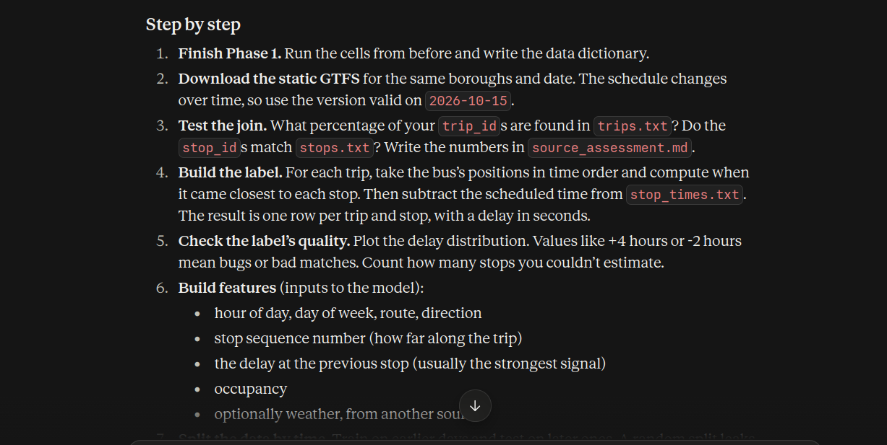
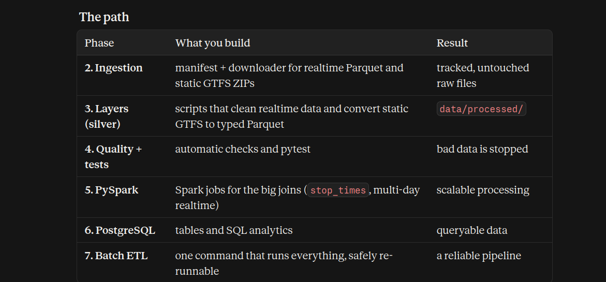

# Bus Observatory Data Engineering Platform

## End-to-End Project Roadmap

**Project type:** Practical data engineering portfolio project\
**Dataset:** Bus Observatory GTFS-Realtime archive\
**Primary objective:** Build a reproducible, tested, containerized data
platform that ingests, validates, processes, stores, orchestrates, and
monitors public-transit data.

> **Important scope rule:** Do not assume the archive contains every
> field required to calculate actual delays or train a delay-prediction
> model. First inspect the available feeds, schema, timestamps, and
> identifiers. Historical vehicle-position data can support ingestion
> and movement analytics, but reliable delay labels require appropriate
> schedule and observed/predicted arrival information.

------------------------------------------------------------------------

# 1. Project goals

By the end, the repository should demonstrate that you can:

-   Run the development environment with Docker Compose.
-   Ingest data from a public source and handle download failures.
-   Preserve raw data and make ingestion repeatable.
-   Process Parquet and GTFS-Realtime-derived records with Python and
    PySpark.
-   Apply data-quality checks and automated tests.
-   Store curated data in PostgreSQL and write analytical SQL.
-   Build an event-streaming extension with Kafka and Spark Structured
    Streaming where feasible.
-   Schedule batch pipelines with Apache Airflow.
-   Monitor pipeline health and expose useful metrics.
-   Document, test, and demonstrate the complete platform.

## Target technology stack

  -----------------------------------------------------------------------
  Area                    Tool                    Why it is used
  ----------------------- ----------------------- -----------------------
  Environment             Docker, Docker Compose  Reproducible local
                                                  multi-service
                                                  environment

  Ingestion               Python,                 Retrieve source data
                          `requests`/`boto3` as   and manage retries
                          appropriate             

  File formats            Parquet, PyArrow        Efficient columnar
                                                  storage and schema
                                                  inspection

  Data processing         Python/Pandas, PySpark  Explore smaller samples
                                                  and process larger
                                                  datasets

  Data quality            Pytest and explicit     Test schemas, keys,
                          validation rules        timestamps, and data
                                                  constraints

  Storage                 Local folders           Separate raw, cleaned,
                          initially; optional     and curated data
                          S3-compatible object    
                          storage later           

  Database                PostgreSQL              Store curated tables
                                                  and serve SQL analytics

  Streaming               Apache Kafka            Demonstrate event
                                                  ingestion and buffering

  Stream processing       Spark Structured        Process events from
                          Streaming               Kafka

  Orchestration           Apache Airflow          Schedule, retry, and
                                                  monitor batch workflows

  Visualization           Grafana                 Show operational and
                                                  transit metrics

  CI                      GitHub Actions          Run tests and basic
                          (optional final stage)  checks automatically
  -----------------------------------------------------------------------

**Build incrementally.** Do not start every service at once. Add tools
only after the preceding stage works and has tests.

------------------------------------------------------------------------

# 2. High-level architecture

## 2.1 Batch data path

``` text
Bus Observatory archive / public object storage
                    |
                    v
           Python ingestion job
      (discover, download, retry, log)
                    |
                    v
              RAW DATA ZONE
       Original Parquet + manifest
                    |
                    v
       PySpark / Python transformations
                    |
                    v
          DATA QUALITY GATE
       schema, nulls, keys, timestamps
                    |
                    v
             CLEAN DATA ZONE
                    |
                    v
          PostgreSQL curated tables
                    |
                    v
              SQL analytics
                    |
                    v
         Dashboard / exported reports
```

## 2.2 Orchestration and operations

``` text
Apache Airflow
      |
      +--> Discover source files
      +--> Ingest new files
      +--> Validate raw data
      +--> Transform data
      +--> Load PostgreSQL
      +--> Run quality checks
      +--> Record run status and metrics

Docker Compose runs the local services.
Logs and metrics help diagnose failures.
```

## 2.3 Optional streaming extension

``` text
Historical files or a permitted live source
                    |
                    v
              Kafka producer
                    |
                    v
                Kafka topic
                    |
                    v
       Spark Structured Streaming
                    |
                    v
       Curated sink / PostgreSQL or Parquet
```

A replay of historical records can demonstrate streaming mechanics, but
it is **not the same as a live real-time transit feed**. Label replay
mode clearly in the documentation.

------------------------------------------------------------------------

# 3. Repository structure

Create and evolve this structure as the project grows:

``` text
transit-data-platform/
├── README.md
├── ROADMAP.md
├── compose.yaml
├── Dockerfile
├── requirements.txt
├── .dockerignore
├── .gitignore
├── .env.example
│
├── config/
│   └── settings.yaml
│
├── data/
│   ├── raw/                 # Never edit original downloaded files
│   ├── bronze/              # Optional normalized/raw landing layer
│   ├── silver/              # Validated, standardized records
│   └── gold/                # Analytics-ready datasets
│
├── src/
│   └── transit_pipeline/
│       ├── __init__.py
│       ├── ingestion/
│       │   ├── discover_files.py
│       │   ├── download_files.py
│       │   └── manifest.py
│       ├── validation/
│       │   ├── schema_checks.py
│       │   └── data_quality.py
│       ├── transformations/
│       │   ├── normalize_records.py
│       │   └── build_features.py
│       ├── storage/
│       │   ├── parquet_io.py
│       │   └── postgres_io.py
│       ├── analytics/
│       │   └── metrics.py
│       └── common/
│           ├── logging_config.py
│           └── settings.py
│
├── sql/
│   ├── 001_create_schema.sql
│   ├── 002_create_indexes.sql
│   └── analytics/
│
├── tests/
│   ├── unit/
│   ├── integration/
│   └── data_quality/
│
├── notebooks/
│   └── 01_dataset_exploration.ipynb
│
├── dags/
│   └── transit_batch_pipeline.py
│
├── streaming/
│   ├── producer.py
│   ├── spark_consumer.py
│   └── README.md
│
├── monitoring/
│   └── dashboards/
│
└── docs/
    ├── architecture.md
    ├── data_dictionary.md
    └── decisions.md
```

Do not create empty files for everything on day one. Add each component
during the relevant phase. Keep large datasets, credentials, virtual
environments, and generated output out of Git.

------------------------------------------------------------------------

# 4. Phase-by-phase implementation plan

## Phase 0 --- Verify the environment

**Goal:** Make sure the development foundation works before touching the
dataset.

Tasks: 1. Check `docker --version`, `docker compose version`, and
`docker info`. 2. Validate the Compose file with
`docker compose config`. 3. Start the initial Python, JupyterLab, and
PostgreSQL services. 4. Check container status and logs. 5. Confirm
JupyterLab opens locally. 6. Connect to PostgreSQL from inside its
container. 7. Confirm project files are mounted and survive container
recreation. 8. Add `.gitignore` and `.env.example`; do not commit
`.env`.

Commands:

``` bash
docker compose config
docker compose up -d --build
docker compose ps
docker compose logs --tail=100
docker compose exec python python --version
docker compose exec postgres psql -U transit_user -d transit_db
```

**Definition of done** - Services start successfully. - JupyterLab is
accessible locally. - PostgreSQL accepts a connection. - Data and
database persistence behavior is understood. - No secrets or large data
files are tracked by Git.

------------------------------------------------------------------------

## Phase 1 --- Dataset reconnaissance and feasibility

**Goal:** Learn exactly what the source contains before designing the
data model.

Tasks: 1. Read the official Bus Observatory documentation and
source/archive information. 2. Identify a small, accessible Parquet
file. 3. Record the source URL/key, feed name, file timestamp, size, and
retrieval time. 4. Read the Parquet schema without loading the entire
dataset when possible. 5. Inspect a small sample of rows. 6. Record
columns, data types, null rates, distinct identifiers, timestamp ranges,
and duplicate patterns. 7. Determine whether records represent vehicle
positions, trip updates, alerts, or another feed type. 8. Check whether
trip identifiers, route identifiers, vehicle identifiers, coordinates,
and timestamps are present. 9. Check whether the relevant static GTFS
schedule is available and compatible. 10. Write a short data dictionary
and feasibility note.

Suggested outputs: - `docs/data_dictionary.md` -
`docs/source_assessment.md` - `notebooks/01_dataset_exploration.ipynb`

**Definition of done** - A sample file has been read successfully. - The
schema and record meaning are documented. - Known limitations are
listed. - You have selected a concrete first dataset/feed and a bounded
time range.

**Important:** Do not decide the final table schema until the actual
columns have been inspected.

------------------------------------------------------------------------

## Phase 2 --- Build robust ingestion

**Goal:** Download or discover source files repeatably and safely.

Implement: 1. A source configuration file rather than hard-coded paths
throughout the code. 2. A file-discovery function or a small explicit
list of known objects for the first version. 3. A downloader with
timeouts, HTTP/status checking where applicable, retries with backoff,
and clear errors. 4. Temporary-file downloads followed by an atomic
rename after success. 5. A manifest recording source key/URL, local
path, file size, checksum, discovery time, download time, and status. 6.
A rule that prevents the same source object from being ingested twice
unnecessarily. 7. Logging for successful downloads and failures. 8. A
dry-run option that lists candidate files without downloading them.

Recommended initial interface:

``` bash
python -m transit_pipeline.ingestion.download_files --limit 1
```

Test cases: - Successful download. - Timeout or unavailable object. -
Invalid or empty file. - Existing file already downloaded. - Interrupted
download does not leave a misleading complete file. - Manifest is
updated correctly.

**Definition of done** - One or more files can be ingested with one
command. - Failures are visible and recoverable. - Rerunning ingestion
does not create uncontrolled duplicates. - Raw source files remain
unchanged.

------------------------------------------------------------------------

## Phase 3 --- Raw, silver, and gold data layers

**Goal:** Separate original data from cleaned and analytics-ready data.

Use a simple medallion-style organization:

-   **Raw/Bronze:** Original source files and source metadata. Preserve
    provenance.
-   **Silver:** Standardized names and types, parsed timestamps,
    normalized records, documented quality flags.
-   **Gold:** Aggregated metrics and datasets designed for specific
    analytical questions.

Tasks: 1. Establish naming conventions and directory partitions based on
fields that actually exist. 2. Preserve source file and source record
identifiers when possible. 3. Parse timestamps consistently and document
timezone assumptions. 4. Standardize types and column names. 5. Add
ingestion metadata such as `ingested_at`, `source_file`, and processing
version where appropriate. 6. Write transformed data to Parquet. 7.
Never silently discard invalid records: quarantine them or retain a
quality status and count. 8. Make transformation outputs reproducible.

**Definition of done** - Raw files are immutable. - Silver outputs have
a documented schema. - Gold outputs answer defined analytical
questions. - Every output can be traced to its source files.

------------------------------------------------------------------------

## Phase 4 --- Data quality and testing

**Goal:** Prevent bad data from moving downstream.

Implement checks appropriate to the discovered schema:

-   Required columns exist.
-   Data types are correct.
-   Key fields are not unexpectedly null.
-   Timestamps parse and fall within expected bounds.
-   Latitude and longitude are within geographic bounds if present.
-   Duplicate detection uses a defensible business key, not blindly all
    columns.
-   Route/trip identifiers follow documented expectations where
    available.
-   File schema changes are detected.
-   Row counts and rejected-row counts are reported.
-   Raw-to-silver record counts reconcile, accounting for quarantined or
    intentionally filtered rows.

Use: - `pytest` for unit and integration tests. - Small synthetic
fixtures for repeatable tests. - A sample real file for integration
testing.

**Definition of done** - Tests can run in Docker. - Invalid examples are
caught by tests. - Data-quality results are logged and stored. - The
pipeline fails or quarantines records according to explicit rules.

------------------------------------------------------------------------

## Phase 5 --- PySpark processing

**Goal:** Learn distributed data transformations using a real pipeline.

Start with a bounded sample, then expand if resources allow.

Tasks: 1. Read Parquet with PySpark. 2. Inspect the schema and
understand lazy evaluation. 3. Filter invalid records and cast columns.
4. Parse and standardize timestamps. 5. Remove duplicates using a
documented key. 6. Join compatible reference data only after verifying
key semantics. 7. Aggregate records by suitable time interval, route, or
feed. 8. Write partitioned Parquet output. 9. Compare the results with a
small Pandas implementation. 10. Measure execution time and explain
partitioning/shuffle choices.

Do not force Spark onto tiny tasks where Python is simpler. The purpose
is to demonstrate the correct use of Spark and understand when
distributed processing is beneficial.

**Definition of done** - A repeatable Spark job transforms raw data into
silver data. - Output schema and counts are tested. - The README
explains the transformation and the reason for using Spark.

------------------------------------------------------------------------

## Phase 6 --- PostgreSQL data warehouse layer

**Goal:** Store curated data and serve analytical SQL queries.

Tasks: 1. Design tables based on the verified source schema. 2. Separate
source metadata, normalized event/observation records, and aggregates
where appropriate. 3. Create tables using versioned SQL scripts. 4.
Define primary keys or deduplication constraints only where the data
supports them. 5. Add indexes based on real query patterns. 6. Load
curated data in batches. 7. Make loading idempotent using a suitable
upsert or staging-and-merge strategy. 8. Handle transactions and failed
loads. 9. Store load/run metadata. 10. Test database access from the
application container.

Possible analytical questions, depending on available fields: - Number
of observations by feed and time interval. - Data freshness and gaps in
collection. - Number of unique vehicles or trips observed per
interval. - Route-level observation coverage when route identifiers
exist. - Distribution of vehicle observations by hour. - Data-quality
failure rates over time. - Movement/speed metrics only when coordinates
and reliable timestamps are available.

**Definition of done** - Schema is versioned. - Loads can be safely
rerun. - Indexes and queries are documented. - SQL results reconcile
with source/processed counts.

------------------------------------------------------------------------

## Phase 7 --- Build a reliable batch ETL pipeline

**Goal:** Combine ingestion, validation, transformation, and loading
into one repeatable workflow.

Target flow:

``` text
Discover new source files
          |
          v
Download and register manifest
          |
          v
Validate raw schema and file integrity
          |
          v
Transform to silver Parquet
          |
          v
Run quality gate
          |
          v
Load curated PostgreSQL tables
          |
          v
Build analytics tables
          |
          v
Record pipeline run status
```

Tasks: 1. Define a command or Python entry point for each stage. 2. Pass
configuration through environment variables/config files. 3. Use clear
exit codes and structured logs. 4. Record run ID, start/end times,
status, input files, row counts, and error details. 5. Support reruns
and recovery from partial failure. 6. Make stages idempotent where
possible. 7. Test failure handling by intentionally making a stage fail.

**Definition of done** - One command runs the end-to-end batch
workflow. - Failed stages are diagnosable. - Re-running does not corrupt
data or duplicate curated rows. - A pipeline run summary is produced.

------------------------------------------------------------------------

## Phase 8 --- Airflow orchestration

**Goal:** Schedule, retry, and monitor batch ETL workflows.

Add Airflow only after the pipeline works as standalone commands.

Create a DAG with tasks similar to:

``` text
discover_files
      |
download_files
      |
validate_raw
      |
transform_to_silver
      |
quality_checks
      |
load_postgres
      |
build_analytics
      |
publish_run_summary
```

Tasks: 1. Add the Airflow services and required metadata database using
a documented Compose setup. 2. Create a DAG with clear task
dependencies. 3. Configure retries, retry delays, timeouts, and catch-up
behavior. 4. Pass only paths and metadata between tasks; do not pass
large datasets through XCom. 5. Make tasks safe to retry. 6. Test a
successful run and a failed task. 7. Check task logs in the Airflow UI.

**Definition of done** - The DAG can run manually and on a schedule. -
Dependencies and retries behave as expected. - A failed task can be
retried without corrupting data. - Setup instructions and resource
requirements are documented.

------------------------------------------------------------------------

## Phase 9 --- Kafka and streaming practice

**Goal:** Learn event ingestion and streaming semantics without
pretending archived data is live.

First choose one mode:

**Mode A --- Historical replay (recommended first):** - Read selected
historical observations. - Convert each valid record to a defined event
schema. - Publish events to a Kafka topic. - Include an event timestamp
and source metadata. - Replay at a controlled rate.

**Mode B --- Live source:** - Only implement this if a suitable,
accessible live feed and its terms are verified. - Document polling
cadence, rate limits, and failure behavior.

Tasks: 1. Run Kafka in Docker Compose using a current, documented local
setup. 2. Create a topic such as `transit-observations`. 3. Implement a
producer with schema validation and useful keys. 4. Implement a consumer
and verify event counts. 5. Test duplicate delivery, producer restart,
consumer restart, and malformed events. 6. Explain delivery semantics
and why consumers should tolerate duplicates. 7. Monitor consumer lag
where available.

**Definition of done** - Events can be produced and consumed reliably in
the chosen mode. - The README clearly states whether the source is
replayed or live. - Duplicate and malformed-event behavior is tested.

------------------------------------------------------------------------

## Phase 10 --- Spark Structured Streaming

**Goal:** Process Kafka events incrementally.

Tasks: 1. Read the Kafka topic with Spark Structured Streaming. 2. Parse
the event schema. 3. Apply timestamp and data-quality checks. 4. Use
event-time windows only after defining the timestamp semantics. 5.
Handle late data/watermarks where relevant. 6. Write results to a
supported sink, such as Parquet checkpoints/output or a carefully
designed database sink. 7. Configure and test checkpoint storage. 8.
Restart the streaming query and verify recovery behavior. 9. Compare
batch and streaming aggregates for the same replayed input.

**Definition of done** - The streaming job processes events
incrementally. - Checkpoints and recovery are understood. - Duplicate
handling and output consistency are documented. - A replayed dataset can
be used to test the pipeline reproducibly.

------------------------------------------------------------------------

## Phase 11 --- Monitoring and observability

**Goal:** Understand pipeline health, not just whether containers are
running.

Track at least: - Last successful ingestion time. - Number of source
files discovered/downloaded. - Download failures and retries. - Input,
valid, rejected, and output row counts. - Processing duration. - Data
freshness and observed time gaps. - PostgreSQL load status. - Airflow
task failures. - Kafka consumer lag when streaming is enabled.

Start with structured logs and a database table containing pipeline run
metadata. Add Grafana dashboards after there are reliable metrics to
display. Choose a metrics exporter or storage integration based on the
services actually deployed.

**Definition of done** - You can identify the last successful run. -
Failed ingestion or transformation is visible. - Dashboard values match
recorded run metrics. - Operational instructions explain how to
investigate common failures.

------------------------------------------------------------------------

## Phase 12 --- Transit analytics and delay feasibility

**Goal:** Produce meaningful transit analytics without inventing
unavailable labels.

First document which fields are present and how records map to trips,
vehicles, routes, and time.

Potential outputs: - Observation coverage by feed/time. -
Vehicle-position counts by time interval. - Collection gaps and data
freshness. - Route or trip coverage when identifiers exist. - Movement
metrics when coordinate and timestamp quality support them.

For genuine delay analysis, establish a compatible reference schedule
and define what "delay" means. A reliable delay target typically
requires scheduled and actual/predicted arrival times matched at a
stop/trip/time level. Vehicle positions alone do not automatically
provide ground-truth arrival delay.

Only after feasibility is proven: 1. Join observations to compatible
static GTFS data. 2. Validate trip/route/stop identifier compatibility.
3. Define and calculate a delay label. 4. Quantify missingness and label
quality. 5. Build a baseline analysis or prediction model as an optional
extension.

**Definition of done** - Every metric has a documented definition. - Any
delay label has a defensible derivation. - Limitations and assumptions
are explicit. - Machine learning is optional, not a substitute for the
data engineering pipeline.

------------------------------------------------------------------------

## Phase 13 --- Docker Compose integration and resource management

**Goal:** Make the complete project reproducible on a local machine.

Tasks: 1. Keep a small default Compose profile for core development. 2.
Add optional profiles or separate Compose overrides for Airflow, Kafka,
and monitoring. 3. Use health checks and service dependencies
appropriately. 4. Use named volumes for persistent database/checkpoint
data. 5. Keep secrets in environment configuration, not source control.
6. Pin tested image versions rather than relying on `latest`. 7. Set
reasonable memory/CPU expectations for local services. 8. Document
startup, shutdown, reset, and troubleshooting commands. 9. Test a clean
setup from the README. 10. Make sure large datasets are not baked into
Docker images.

Useful commands:

``` bash
docker compose config
docker compose up -d --build
docker compose ps
docker compose logs -f
docker compose down
```

Do not delete persistent volumes during normal shutdown. Use a
volume-removal command only when you intentionally want to erase stored
state.

**Definition of done** - Another developer can follow the README to
launch the core stack. - Optional services can be started when needed. -
State persistence and reset behavior are clearly explained. - The stack
fits the available computer resources.

------------------------------------------------------------------------

## Phase 14 --- Documentation, CI, and portfolio delivery

**Goal:** Present the work as a professional engineering project.

README should include: 1. Problem statement and goals. 2. Architecture
diagram. 3. Data source, license, and attribution. 4. Verified schema
and data limitations. 5. Technology choices and rationale. 6. Local
setup instructions. 7. Pipeline execution commands. 8. Database schema
and sample SQL queries. 9. Test instructions and quality results. 10.
Screenshots of Airflow/Grafana only if implemented. 11. Known
limitations and future work.

Add optional GitHub Actions for: - Python linting/format checks. - Unit
tests. - Basic configuration validation. - Build checks for the core
Docker image.

Never commit API tokens, passwords, private data, or large source
datasets.

**Definition of done** - A fresh clone can be set up from the
documentation. - Tests are runnable and their results are clear. - The
architecture and limitations are easy to understand. - You can explain
why each technology is used and what problem it solves.

------------------------------------------------------------------------

# 5. Recommended implementation order

Follow this order rather than trying to learn all tools simultaneously:

  -----------------------------------------------------------------------
  Milestone               Deliverable             Main tools
  ----------------------- ----------------------- -----------------------
  1                       Working local           Docker, Compose,
                          environment             Python, Jupyter,
                                                  PostgreSQL

  2                       Dataset assessment and  PyArrow, Pandas,
                          data dictionary         Parquet

  3                       Repeatable downloader   Python, HTTP/S3 access,
                          and manifest            logging

  4                       Bronze/silver Parquet   Python, PySpark
                          outputs                 

  5                       Automated quality       Pytest, validation code
                          checks                  

  6                       Curated database and    PostgreSQL, SQL
                          SQL analytics           

  7                       End-to-end batch        Python, PySpark,
                          pipeline                PostgreSQL

  8                       Scheduled and retryable Airflow
                          pipeline                

  9                       Event production and    Kafka
                          consumption             

  10                      Incremental event       Spark Structured
                          processing              Streaming

  11                      Operational dashboards  Grafana and selected
                                                  metrics source

  12                      Delay analysis if       GTFS matching,
                          labels are valid        SQL/Python; ML optional

  13                      Reproducible delivery   Docker Compose,
                                                  documentation, CI
  -----------------------------------------------------------------------

**The first complete version should stop after milestone 7 if needed.**
A reliable, tested batch pipeline is more valuable than a large stack of
services that does not work end to end.

------------------------------------------------------------------------

# 6. Core engineering principles to demonstrate

## Idempotency

Running a stage twice should not duplicate data or damage existing
results.

## Incremental processing

Process only newly discovered files or records when the source supports
reliable change detection.

## Data lineage

Keep enough metadata to trace curated outputs back to source files and
processing runs.

## Data quality

Define rules, measure failures, and make explicit decisions about
quarantine versus pipeline failure.

## Fault tolerance

Use retries for transient failures, but avoid infinite retries for
invalid data or permanent errors.

## Observability

Log useful context and record counts, durations, and failure states.

## Schema management

Detect unexpected schema changes rather than silently assuming the input
is stable.

## Security

Keep credentials out of Git, restrict exposed ports to local
development, and use development-only passwords only for local testing.

## Cost and resource awareness

Start with small samples and optional services. Measure resource use
before scaling up.

------------------------------------------------------------------------

# 7. Project acceptance checklist

-   [ ] Docker Compose environment starts reliably.
-   [ ] Source dataset and license/attribution are documented.
-   [ ] Schema and limitations are verified from real sample files.
-   [ ] Ingestion is repeatable and logged.
-   [ ] Raw data is preserved.
-   [ ] Transformations produce documented Parquet outputs.
-   [ ] Data-quality checks and tests pass.
-   [ ] PostgreSQL loads are safe to rerun.
-   [ ] Analytical SQL queries are documented.
-   [ ] A single batch workflow can run end to end.
-   [ ] Airflow schedules and retries the workflow.
-   [ ] Kafka producer/consumer works in clearly labeled replay or live
    mode.
-   [ ] Spark Structured Streaming processes events and recovers from
    restart.
-   [ ] Operational metrics are available.
-   [ ] Grafana displays real metrics if the dashboard stage is
    implemented.
-   [ ] Delay calculations are included only if their data requirements
    are satisfied.
-   [ ] README explains setup, commands, tests, architecture, and
    limitations.

------------------------------------------------------------------------

# 8. Official references

Check the documentation for the versions you actually deploy:

-   Bus Observatory documentation: https://api.busobservatory.org/docs
-   Docker Engine installation: https://docs.docker.com/engine/install/
-   Docker Compose: https://docs.docker.com/compose/
-   Apache Spark documentation: https://spark.apache.org/docs/latest/
-   Apache Kafka documentation: https://kafka.apache.org/documentation/
-   Apache Airflow documentation: https://airflow.apache.org/docs/
-   PostgreSQL documentation: https://www.postgresql.org/docs/
-   Pytest documentation: https://docs.pytest.org/
-   Grafana documentation: https://grafana.com/docs/

Verify source availability, feed details, and license terms before large
downloads or publication. The source archive may change over time.

------------------------------------------------------------------------

# 9. Immediate next step

Once the initial Docker environment is ready:

1.  Confirm Python, JupyterLab, and PostgreSQL work inside their
    containers.
2.  Read one small Bus Observatory Parquet file.
3.  Print its schema, sample rows, and timestamp range.
4.  Write `docs/data_dictionary.md` and `docs/source_assessment.md`.
5.  Only then finalize the ingestion contract and database schema.

**Success means a reliable, testable, documented data platform---not
merely a collection of installed tools.**





